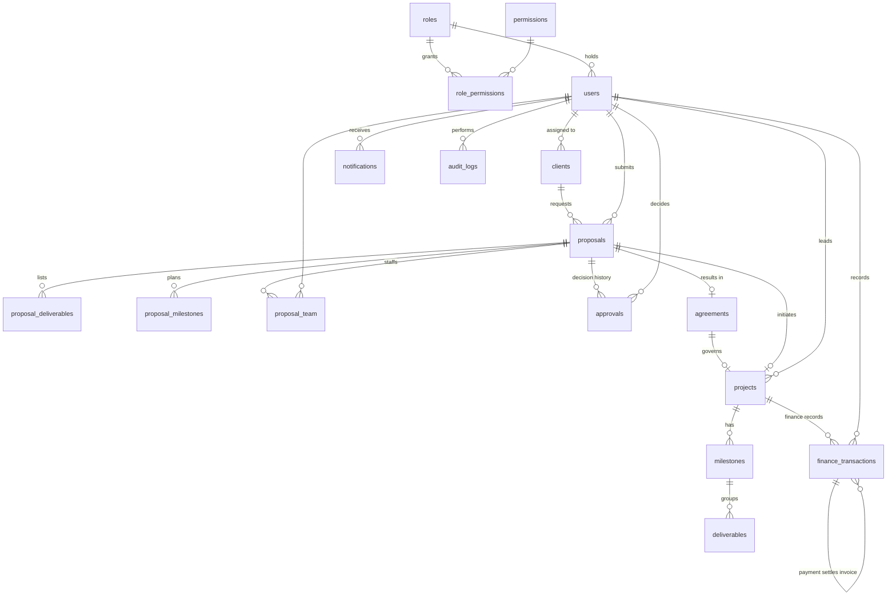

# CPTS — Consultancy Project Tracking System (prototype)

Interactive prototype for CS314 Software Development Lab, Team T086. It implements the
requirements, business rules and UML models from Lab Assignments 1–5 using sample data.

> A Node API backed by MySQL stores the data and enforces the business rules.
> Sign-in needs an @lnmiit.ac.in address, a password and a one-time code sent by
> e-mail. No payment gateway or external system is connected.

## Run

Needs **Node 20.11+** and **MySQL 8.0.16+** (developed on MySQL 9.5).

1. Make sure the MySQL service is running.
2. Copy `.env.example` to `.env` and set `MYSQL_USER` and `MYSQL_PASSWORD`
   (`root` and your root password is fine on your own machine).
3. Start:

```bash
npm install
npm run dev        # web on http://localhost:5173, API on http://localhost:3001
```

On first start the API creates the `cpts` database and all tables
(`server/db/schema.sql`) and loads the sample data. After that, data lives in MySQL and
survives restarts. `npm run db:reset` drops and recreates the tables with fresh sample data.

No MySQL on a machine? Set `DATA_STORE=json` in `.env` to use a local file instead.

```bash
npm run build      # type-check + production build into dist/
npm start          # one server on :3001 serving the built app and the API
```

Signing in needs the API. If the API stops during a session, the
app keeps working on browser-only data and the header shows **Offline: saved in this browser**.

## Sign-in: LNMIIT email + one-time code

1. Enter an address ending in `@lnmiit.ac.in` (any other domain is refused, in the browser
   and on the server) and the password.
2. The server e-mails a 6-digit code. It expires in 5 minutes, works once, allows 5 wrong
   tries, and a new one can be requested after 30 seconds.
3. Only after the code is verified does the server issue a session.

**Without e-mail set up (default)** the server prints the code in the terminal running
`npm run dev`, and the sign-in screen says so:

```
[otp] Code for meera.iyer@lnmiit.ac.in: 482913  (valid 5 min; e-mail not configured)
```

**To send real e-mails**, copy `.env.example` to `.env` and fill in SMTP settings. For a
Gmail / LNMIIT Google account: turn on 2-step verification, create an App Password, and use
it as `SMTP_PASS`. Restart `npm run dev`. `.env` is git-ignored; never commit it.

The demo accounts use made-up addresses such as `meera.iyer@lnmiit.ac.in`, which could
belong to a real person. Set `OTP_REDIRECT_TO=your.inbox@lnmiit.ac.in` so every code goes
to your inbox instead (the e-mail says which account it is for).

## Demo accounts

Password for every account: `demo123` (also selectable on the sign-in page). A one-time
code is still required for each sign-in.

| Account | Role |
|---|---|
| meera.iyer@lnmiit.ac.in | Faculty Consultant (R01) |
| sanjay.mehta@lnmiit.ac.in | Proposal Approver (R02) |
| rohit.verma@lnmiit.ac.in | Administrator (R03) |
| neha.gupta@lnmiit.ac.in | Finance/Accounts Officer (R04) |
| anand.krishnan@lnmiit.ac.in | Institute Management (R05) |

Switch accounts from the avatar menu (top right); you get a fresh code for the new account. **Reset sample data** in the same menu
restores the original data on the server before a demo. Open two browsers (for example
faculty and approver) to watch changes appear in the other window within a few seconds.

## Suggested demo script

1. **UC-004 Submit Proposal** — as Meera: *New proposal* → click *Submit for approval*
   with empty fields (validation) → fill the form → submit. Or open draft P050 and submit
   it; P049 is deliberately incomplete.
2. **UC-005 / UC-006 Approve or Reject** — as Prof. Mehta: *Review queue* → open the
   proposal (status moves to Under Review) → Approve (stamp appears) or Reject (reason
   required). A decided proposal can’t be decided again.
3. **UC-007 Finalize Agreement** — open P044 (approved) → *Finalize agreement* → a project
   (PR032) is created and accounts are notified to record its budget.
4. **UC-010 Record Finance Transaction** — as Neha: *Finance* → *Record transaction*.
   The four checks of State Diagram 02 run live:
   - PR032: an invoice before a budget is refused (BR-003); record the budget first.
   - An invoice above the remaining budget is refused (BR-006).
   - Reusing payment reference `UTR HDFC26091577310` is refused as a duplicate of T118 (BR-005).
   - PR029 is cancelled, so it refuses any transaction (BR-010).
5. Check the dashboard, notifications and audit log (as Rohit) for the effects.

The Lab 4 object-diagram instance is in the data: client C017, proposal P042,
agreement A031, project PR031, payment T118 of ₹1,50,000 recorded by U104.

## Backend

```
Browser (React)                     Server (Express)                     MySQL
  actions.submitProposal(...) --->  POST /api/actions { name, args }
   1. runs the engine locally        1. checks the signed session token
      (instant feedback)             2. runs the same engine on its copy
   2. sends the action               3. IDataAccess.commit():  ----------> one transaction:
   3. adopts the server's data <---  4. returns result + new data            only changed rows
```

Changes are applied one at a time. The database is written first; if MySQL refuses
(a constraint, a lost connection), the transaction rolls back, the server keeps its previous
data, and the browser shows **Not saved** and reverts its preview.

| Endpoint | Purpose |
|---|---|
| `POST /api/login` | Check domain and password, e-mail a one-time code (same error for every failed login, FR-002) |
| `POST /api/login/verify` | Check the code, return a signed 12-hour session token |
| `POST /api/login/resend` | Send a new code (after 30 s) |
| `GET /api/state` | Current data; the browser polls it every few seconds |
| `POST /api/actions` | Run one use case as the signed-in user |
| `POST /api/reset` | Restore sample data (demo only) |
| `GET /api/health` | Liveness check |

The use cases live in `src/store/engine.ts` and the rules in `src/store/rules.ts`. The
server and the browser run the same code, so a rule cannot be skipped by calling the API
directly. Deactivating a user blocks their next request immediately.

**Known limits (prototype):** every signed-in user
receives the full data set and the screens do the filtering (a production system must filter
on the server, NFR-006); demo accounts share one password; pending codes are kept in memory,
so restarting the server cancels them; reset is open to any signed-in user.

## Database

One table per class of the class model (Lab 4, §33.1), plus Milestone and Deliverable
(Lab 2, §16) and join tables for multi-valued attributes. The full, commented DDL is
[server/db/schema.sql](server/db/schema.sql).

| Class (Lab 4) | Table | Key relationships |
|---|---|---|
| Role | `roles`, `role_permissions` → `permissions` | User 0..* — Role 1 |
| User | `users` | password stored as an scrypt hash |
| Client | `clients` | Client 1 — Proposal 0..* |
| Proposal | `proposals` + `proposal_deliverables`, `proposal_milestones`, `proposal_team` | FR-007 fields |
| Approval | `approvals` | composition of Proposal |
| Agreement | `agreements` | Proposal 1 — Agreement 0..1 |
| Project | `projects` | Agreement 1 — Project 0..1 |
| FinanceTransaction | `finance_transactions` | composition of Project; a payment references its invoice |
| Milestone / Deliverable | `milestones`, `deliverables` | deliverable → milestone of the same project (FR-032) |
| Notification | `notifications` | User 1 — Notification 0..* |
| AuditLog | `audit_logs` | User 1 — AuditLog 0..* |



**Rules the database enforces on its own** (a write that breaks them is refused even if it
bypasses the application):

| Constraint | Rule |
|---|---|
| `ck_users_institute_email` | accounts must be `@lnmiit.ac.in` |
| `ck_approvals_reason` | a rejection needs a reason (FR-013) |
| `uq_agreements_proposal` | one agreement per proposal (BR-002) |
| `uq_txn_one_budget_per_project` | one approved budget per project (FR-021) |
| `uq_txn_reference` | the same invoice number or payment reference can't be recorded twice (BR-005) |
| `ck_txn_payment_has_invoice`, `fk_txn_invoice` | a payment settles an invoice of the same project |
| `ck_txn_amount` | amounts are positive |
| `fk_deliverables_milestone` | a deliverable's milestone belongs to the same project (FR-032) |
| `ck_projects_cancel_reason` | a cancellation is explained (FR-015) |
| `ck_proposals_submitted`, `ck_proposals_dates` | submitted proposals have a submission date; end after start |

Rules that depend on running totals (BR-006 budget ceiling, BR-010 cancelled projects,
BR-003 agreement before finance) are checked by the application in `src/store/rules.ts`.

The application reaches the database only through `IDataAccess` (`server/db/IDataAccess.ts`),
the Data Access Layer of the component diagram (Lab 5, §39). `MySqlDataAccess` implements it
for MySQL; `JsonFileDataAccess` is the fallback.

## Structure

```
server/       index.ts (Express API), otp.ts (one-time codes), mailer.ts (SMTP), env.ts
  db/         schema.sql (MySQL DDL), IDataAccess.ts, MySqlDataAccess.ts,
              JsonFileDataAccess.ts (fallback), passwords.ts (scrypt), index.ts (store choice)
  scripts/    db-reset.ts (npm run db:reset)
  data/       session-signing secret (and db.json only with DATA_STORE=json)
src/
  lib/        api.ts (fetch helper), auth.ts (@lnmiit.ac.in rule), format.ts, router.tsx
  data/       types.ts (class model, Lab 4 §33) · seed.ts (sample data)
  store/      rules.ts (business rules BR-001…BR-010, UC checks)
              engine.ts (every use case: actions, notifications, audit log)
              store.tsx (browser client: runs the engine, syncs with the server)
              scope.ts (role-based visibility)
  components/ Shell (navigation by role), ui (design system), domain (lifecycle, charts)
  pages/      Dashboard, Proposals, ProposalForm, Approvals, Agreements, Projects,
              Finance, Clients, Notifications, Users, Audit, Reports
```
